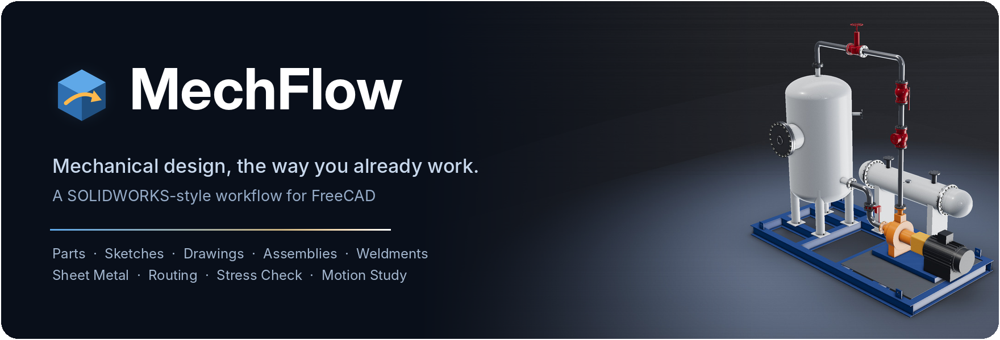
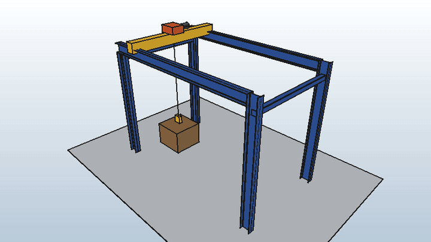
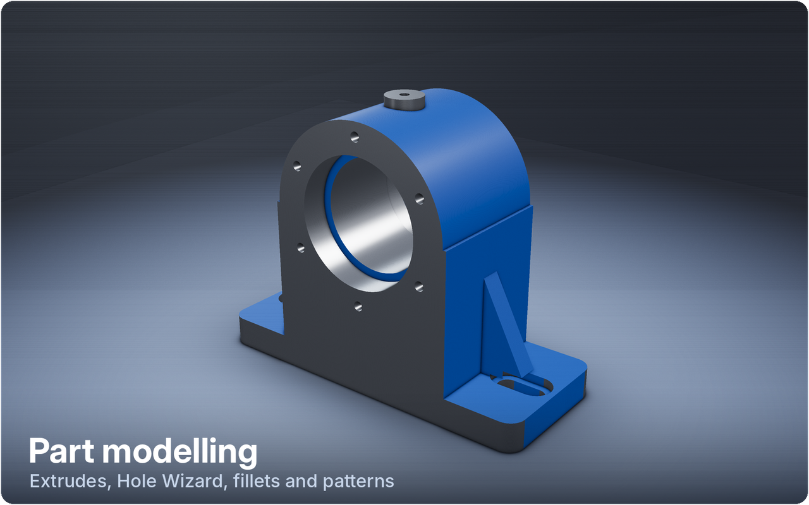
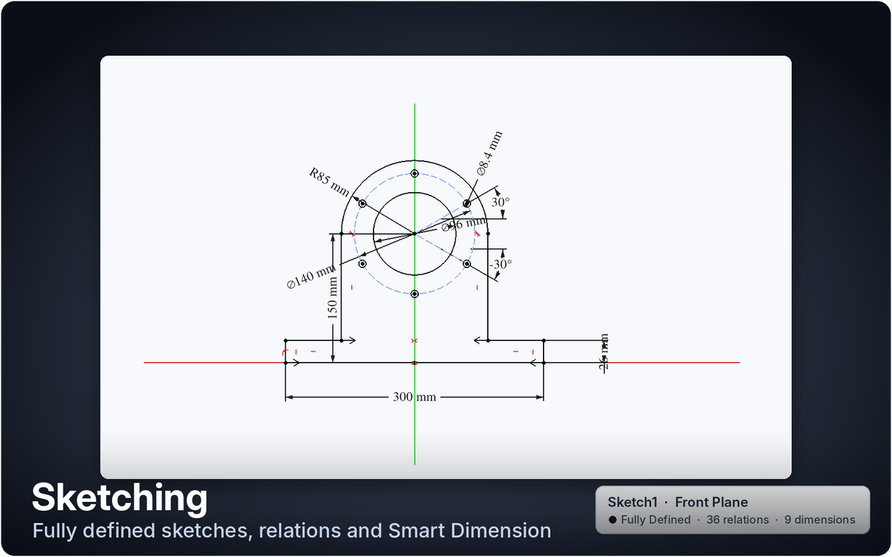
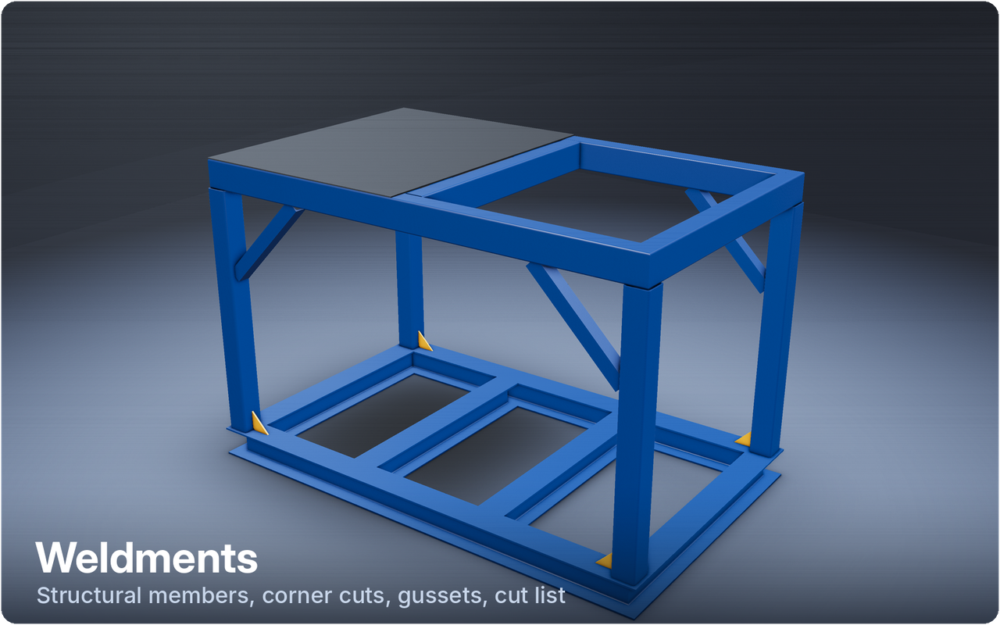
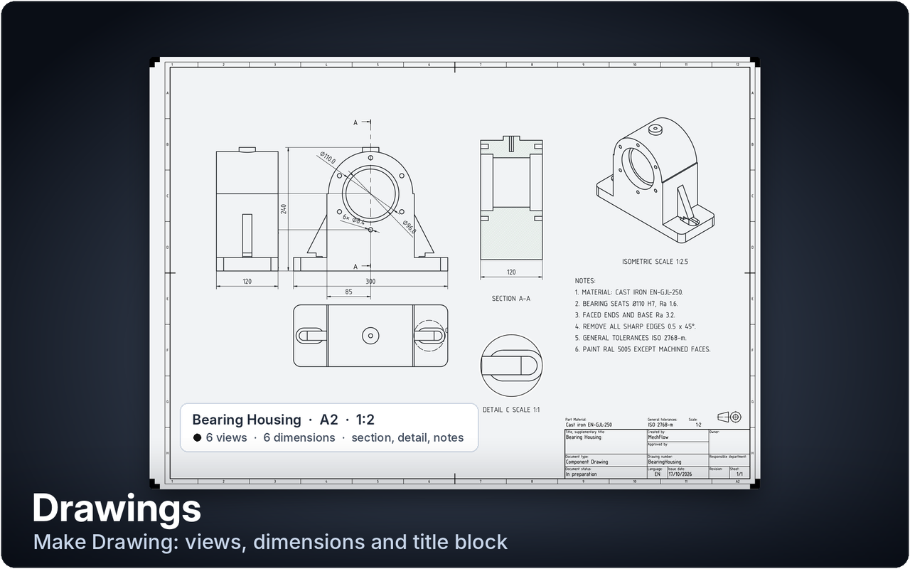
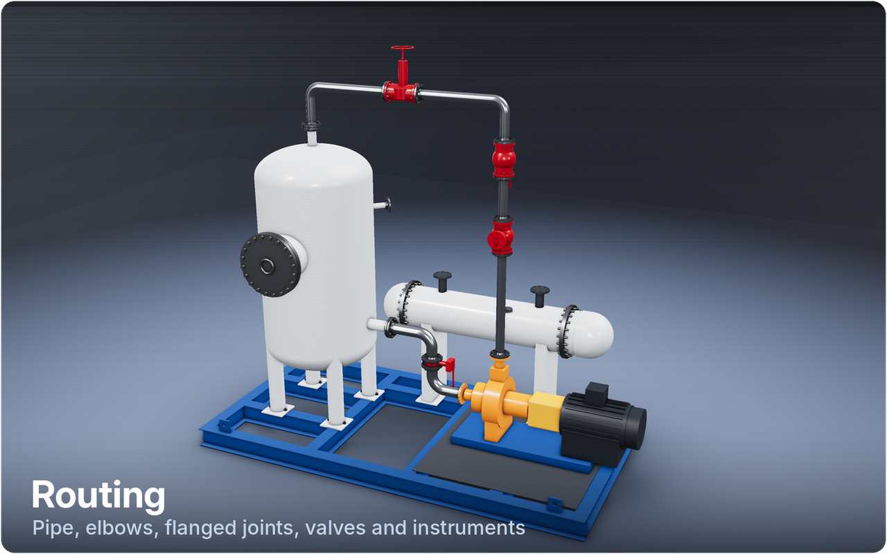
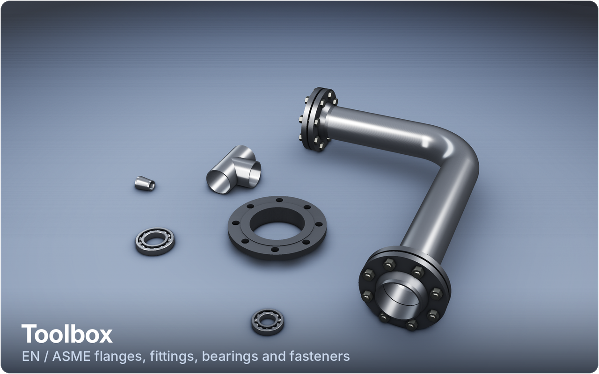
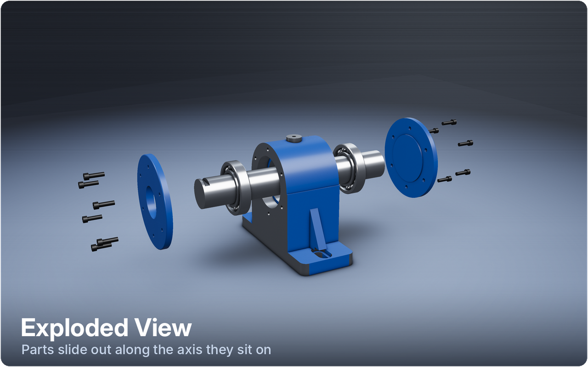
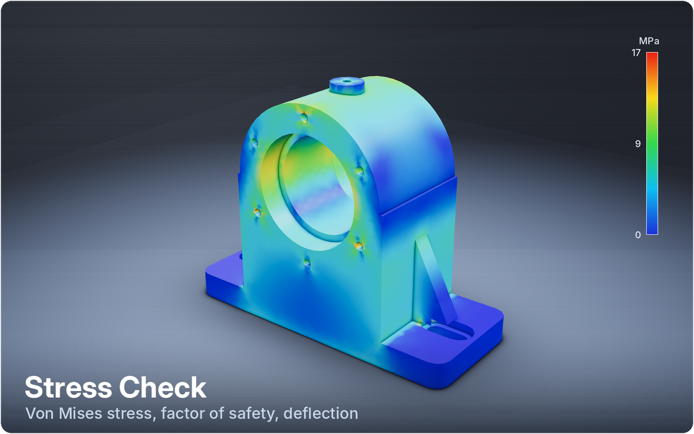

<p align="center">
  
</p>

<p align="center">
  <a href="https://github.com/Eventhori3on/MechFlow/releases/latest"></a>
  
  
  <a href="LICENSE"></a>
</p>

<p align="center">
  <b>A SOLIDWORKS-style workflow for FreeCAD. Free and open source.</b><br>
  <a href="#highlights">Highlights</a> ·
  <a href="#feature-guide">Feature guide</a> ·
  <a href="#install">Install</a> ·
  <a href="#quick-start">Quick start</a> ·
  <a href="#good-to-know">Good to know</a> ·
  <a href="#contributing">Contributing</a>
</p>

---

MechFlow is a FreeCAD workbench for mechanical engineers who know SOLIDWORKS
and don't want to relearn everything to use free software. It sits on top of
**FreeCAD 1.1**: you keep FreeCAD's geometry kernel, solver and open file
format, and get the CommandManager, tool names, dialogs and day-to-day
workflow you already use, from the first sketch to the supplier pack.

<p align="center">
  <br>
  <sub><i>Motion Study, new in 0.31: keyframe a model's parameters and the camera, then export the video.</i></sub>
</p>

## Highlights

<table>
<tr>
<td width="33%" valign="top">

<b>🧊 Part modelling</b><br>
Extrude, Revolve, Sweep, Loft, Fillet, Shell, Hole Wizard and patterns, each
with its own panel and in-view drag handles. Configurations with a Design
Table.

</td>
<td width="33%" valign="top">

<b>✏️ Sketching</b><br>
Blue / black / red definition colours, a Relations panel, Smart Dimension and
live linear and circular sketch patterns.

</td>
<td width="33%" valign="top">

<b>🏗️ Weldments</b><br>
Structural members in UK sections (UKB, UKC, PFC, angle, SHS / RHS, CHS),
corner treatments, trim / extend, end caps, gussets and a cut list.

</td>
</tr>
<tr>
<td valign="top">

<b>📐 Drawings</b><br>
One-click part and assembly drawings with dimensions, BOM and balloons, an
editable title block, your own client sheets, and a one-button
<b>Supplier Pack</b> (PDF, STEP, DXF, CSV).

</td>
<td valign="top">

<b>🔩 Assemblies & Toolbox</b><br>
Mates with SOLIDWORKS names, EN / ASME flanges, pipe, fittings and bearings,
ISO / DIN fasteners that size themselves to the hole, Smart Fasteners,
Exploded View and Interference Detection.

</td>
<td valign="top">

<b>🛢️ Routing</b><br>
Draw pipe straight into the model with real elbows, tees, flanges and valves,
use pipe specs and size changes, and trace existing pipework from a
<b>3D scan</b>.

</td>
</tr>
<tr>
<td valign="top">

<b>🪛 Sheet metal</b><br>
Base Flange, Edge Flange, Hem, Sketched Bend and more, with flat patterns
saved as DXF for the laser.

</td>
<td valign="top">

<b>📊 Stress Check</b><br>
A SimulationXpress-style linear static check: fixtures, forces, pressure,
water pressure and self-weight, giving von Mises stress, factor of safety
and deflection.

</td>
<td valign="top">

<b>🎬 Motion Study</b><br>
Animate parameters and configurations with eased keyframes, move the camera
(field of view, orbits) and export to MP4, GIF or PNG frames.

</td>
</tr>
</table>

### Gallery

<p align="center">
  
  
</p>
<p align="center">
  
  
</p>
<p align="center">
  
  
</p>
<p align="center">
  
  
</p>

### If you know SOLIDWORKS, you know where things are

| SOLIDWORKS | MechFlow |
|---|---|
| CommandManager tabs | Features · Sketch · Weldments · Sheet Metal · Evaluate · Drawing · Assembly · Routing |
| Extruded / Revolved / Swept / Lofted Boss/Base and Cut | Same names, same options (end conditions, Direction 2, draft, thin feature) |
| Hole Wizard, Fillet, Chamfer, Shell, Draft, patterns, Mirror | Same names |
| Configurations and Design Table | **Configurations** with a Design Table |
| Weldments, Structural Member, Cut List | Same names |
| Mates, Toolbox, Smart Fasteners, Exploded View | Same names |
| Routing (Tube and Pipe) | **Routing** tab: Draw Pipe, Route Pipe, Valves & Instruments, Pipe Specs |
| SimulationXpress | **Stress Check** |
| Motion Study (Animation) | **Motion Study** |
| Pack and Go for suppliers | **Supplier Pack** |

---

## Feature guide

Every tool has its own panel, and you edit a feature again by
double-clicking it. Click a heading to expand it.

<details>
<summary><b>Interface</b>: CommandManager, heads-up view bar, SOLIDWORKS names</summary>

- **CommandManager** with Features, Sketch, Weldments, Sheet Metal, Evaluate,
  Drawing, Assembly and Routing tabs. It switches tab to match what you're
  doing (sketching, a drawing, an assembly).
- SOLIDWORKS names throughout: *Extruded Boss/Base*, *Convert Entities*,
  *Smart Dimension*, *Mate*, and so on.
- Floating heads-up view bar (you can drag it), **Normal To** (Ctrl+8), S-key
  shortcut bar, confirmation corner in sketches, light theme.
- Front/Top/Right planes you can hover, click and right-click → Sketch.
- Optional **MechFlow splash screen** (*MechFlow → Use MechFlow Splash
  Screen*). FreeCAD reads its splash from a small `branding.xml` next to the
  FreeCAD program, so on Windows this asks once for administrator permission.
  Updating FreeCAD removes the file; MechFlow then offers to put it back.

</details>

<details>
<summary><b>Part modelling</b>: features, Hole Wizard, nozzles, patterns, configurations</summary>

- **Extruded Boss/Base and Cut:** end conditions, Direction 2, draft, **Thin
  Feature**, and a drag arrow with a depth box in the 3D view.
- **Revolved** Boss/Cut, **Swept** and **Lofted** Boss/Cut.
- **Fillet** and **Chamfer** on many edges at once, **Shell**, **Draft**.
- **Hole Wizard:** ISO M3–M20 simple, counterbore, countersink and tapped
  holes; ISO 273 close / normal / loose clearance; Blind, **Up To Next**
  (through the first wall only, for tanks and hollow parts) or Through All.
- **Nozzle:** click a tank or vessel wall, flat or curved, and pick the pipe
  (EN 10220 or ASME B36.10M) and its standout. The stub is shaped to meet
  the shell, only the wall it sits on is bored, and a weld neck or plate
  flange can go straight on the end. Position it exactly by typing X, Y, Z;
  point it square to the face or along an axis.
- **Linear Pattern** (with a spacing drag arrow), **Circular Pattern**,
  **Mirror**.
- **Reference Plane** (offset, at angle, mid plane, through a point, 3
  points, normal to curve, tangent) with drag handles, and **Axis**.
- **Rollback**, **Suppress/Unsuppress**, **Section View** (up to three
  sections with a drag handle, on parts and whole assemblies), **Edit
  Material** and **Mass Properties** (a body, a weldment part or a whole
  assembly).
- **Configurations** with a **Design Table**: one part file, several
  versions of it. Columns are named sketch dimensions, feature values
  (depths, wall thickness, hole depths, member sizes) or a feature's
  suppression; rows are configurations. Double-click one to rebuild the part
  to it; *Save model values* writes your edits back into the table.

</details>

<details>
<summary><b>Sketching</b>: definition colours, Relations panel, sketch patterns</summary>

- Under-defined geometry **blue**, fully defined **black**, over-defined
  **red**. The status bar shows *Under Defined (n DOF)* / *Fully Defined* /
  *Over Defined*.
- **Relations panel:** select entities and add the relations that fit them
  (Coincident, Horizontal, Midpoint, Tangent, Concentric, Collinear, ...).
  **Display/Delete Relations** lists the existing ones.
- Smart Dimension snaps to model edges without a Convert Entities step.
- **Linear and Circular Sketch Pattern** panels. Linear: Direction 1 and 2
  (angle or a picked line, spacing, instances, reverse) for rows and grids.
  Circular: centre (origin or a picked point), angle, instances, equal
  spacing, reverse. Both preview live, and the result is constrained so it
  follows the original.
- The Sketch tab has the full set: Centre Rectangle, 3 Point Arc, Sketch
  Chamfer, Extend/Split, Move/Copy/Scale, Repair Sketch.

</details>

<details>
<summary><b>Weldments</b>: structural members, trim/extend, end caps, gussets, cut list</summary>

- **Structural Member:** pick sketch lines (from one sketch or several, so
  3D frames work) and a section: UKB, UKC, PFC, equal angle, SHS / RHS (hot
  finished EN 10210 or cold formed EN 10219) or CHS, in UK sizes. Corners
  are cut with **End miter**, **End butt 1** or **End butt 2**; a member that
  ends on the side of another (a cross rail, a post) is cut square to its
  face. Rotate or mirror the profile; double-click to edit.
- **Trim/Extend:** trim or extend one member group's free ends to other
  members (cut square to the face) or to any body (cut to its shape).
- **End Cap** on tube ends (outward or inward, inset), or a bigger **base
  plate** with an anchor hole in each corner, and **Gusset** plates between
  two member faces (legs, thickness, corner relief).
- A weldment part stays **one part**: members, plates and gussets go into a
  Part container with the body (named after the file), so Insert Components
  brings the whole thing into an assembly.
- **Cut List:** members grouped by section and length, with the cut angles,
  plus end caps and gussets, saved as a spreadsheet.

</details>

<details>
<summary><b>Sheet metal</b>: flanges, bends, flat pattern to DXF</summary>

- A **Sheet Metal** tab with SOLIDWORKS names: Base Flange/Tab, Convert to
  Sheet Metal, Edge Flange, Sketched Bend, Hem, Extend Tab, Extruded Cut,
  Corner and Bend Relief, Rip, Insert Bends, Forming Tool.
- **Flatten** shows the flat pattern (click again to fold back) and **Save
  Flat as DXF** writes it for the laser.
- Uses the free **SheetMetal Workbench** (Addon Manager); MechFlow offers to
  install it the first time.

</details>

<details>
<summary><b>Drawings</b>: automatic drawings, title blocks, client sheets, Supplier Pack</summary>

- **Make Drawing from Part:** pick a sheet (ISO A4–A0, ANSI A–D) and get a
  standard 3 view plus an isometric, at a standard scale that fits the sheet
  clear of the title block, with overall dimensions, an "n x ⌀" callout and
  a position for each size of hole, and the weldment cut list as a table.
  Projection is first-angle for ISO sheets and third-angle for ANSI.
- **Make Drawing from Assembly** (same button, with an assembly open): an
  isometric with the **BOM table** and a numbered **balloon** on every BOM
  item, plus a dimensioned sheet for each part ("Auto" picks a bigger sheet
  only when it allows a bigger scale). **Save All as PDF** writes every
  sheet, numbered, into one folder. On big assemblies, bolts, nuts and
  washers are left out of the view by default (FreeCAD's drawing views slow
  down sharply with hundreds of fasteners); they stay in the BOM.
- **Supplier Pack** (Assembly and Drawing tabs): everything a fabricator
  needs from one button, in a folder and a zip:
  - the assembly sheet, and an **exploded view** sheet with balloons;
  - a dimensioned sheet per part (PDF);
  - STEP of the assembly and of each part;
  - **DXF flat profiles** for plasma or laser cutting: every flat plate, each
    wall of a plate-built part such as a tank, and sheet metal flat
    patterns. Identical profiles (even turned over) are counted together, and
    the file names give thickness and quantity;
  - the BOM and weldment cut list as CSV, and a contents list.
- The title block fills in from the part: name, material, scale, author,
  date, sheet, and weight on ANSI sheets. Text too long for its box is made
  smaller to fit (also when you type straight into the drawing).
- **Title Block** (Drawing tab, or right-click the sheet): every box in a
  list. Type in it, pick its font and size, bold, nudge it right or up.
  **Move to sheet** makes a box's text a note you can drag anywhere and
  restyle; **Put back in box** returns it.
- **Text Box:** type a note, pick the font, size (capital height in mm),
  bold / italic, colour and a wrap width; drag it into place. Double-click a
  note to change it; **Ctrl + mouse wheel** over a selected note makes it
  bigger or smaller.
- **Projected views drag apart:** the views are laid out once, then let go,
  so you can drag the top view up or down and the side view left or right.
  Each slides along its line from the front view, so they stay aligned (drag
  the front view to move them all). **View Spacing** sets the gap between
  them all at once. **Break Alignment** (right-click a view) frees it to go
  anywhere, its dimensions going with it, and **Default Alignment** puts it
  back in line.
- **Client Sheet:** bring in a client's border and title block as **DXF**
  (lines, polylines, arcs, circles, ellipses, splines, text, MTEXT and
  blocks; block attributes become boxes to type in), **SVG**, or a
  **picture** (PNG / JPG; PDF where FreeCAD's Qt can read it). Keep it the
  size it was drawn or fit it to a standard sheet, tick any text you want to
  type over, and it's kept in your sheet formats so Make Drawing lists it.
- **Right-click on the drawing** gives the choices for what's under the
  mouse (Break / Default Alignment, View Spacing, Edit Text) and Add Text Box
  Here, Title Block and Client Sheet, above FreeCAD's own.
- The Drawing tab has Model / Projected / Section / Detail views, View
  Spacing, Break / Default Alignment, Smart Dimension, Text Box, Note,
  Balloon, Centre Mark, Hatch, Surface Finish, Weld, Sheet Format, Title
  Block, Client Sheet, Scan View and Save as PDF / DXF.

</details>

<details>
<summary><b>Assemblies</b>: mates, BOM, Exploded View, Interference Detection</summary>

- **New Assembly** and **Insert Components**.
- **Mate panel:** click a face, edge or point on two parts and MechFlow
  suggests the mate (Concentric, Coincident, Tangent). Other mates: Parallel,
  Perpendicular, Lock, Distance, Angle, Hinge, Slider. **Aligned /
  Anti-Aligned** flips the part. Mates show in a *Mates* folder with
  SOLIDWORKS names.
- **Bill of Materials** with ITEM NO. / PART NUMBER / DESCRIPTION / QTY.,
  counting identical parts and fasteners together.
- **Interference Detection:** touching parts aren't counted, and results
  are remembered so re-checking after an edit is quick.
- **Exploded View:** the biggest part stays put and every other one slides
  out along the axis it sits on (a nozzle's gasket, flanges and pipe spread
  out along the nozzle, a door comes off its side), bolts going with what
  they hold. Click again to put it back; the assembly and its mates aren't
  changed.

</details>

<details>
<summary><b>Toolbox and Smart Fasteners</b>: flanges, pipe, fittings, bearings, fasteners</summary>

Standard parts, browsed by category and standard:

- **Flanges:** EN 1092-1 Type 11 weld neck, Type 01 plate and Type 05 blind
  (PN16, PN25, PN40, DN10–DN600); ASME B16.5 weld neck, slip-on and blind,
  RF (Class 150 and 300, NPS ½–12).
- **Pipe:** EN 10220 (ISO 4200 sizes) and ASME B36.10M (Sch 10/40/80), any
  length.
- **Pipe fittings:** EN 10253-2 90° elbows (2D, 3D, 5D), 45° 3D elbows,
  equal tees, concentric reducers and caps, with the EN 10220 pipe wall;
  ASME B16.9 90° and 45° long radius elbows, equal tees, concentric reducers
  and caps. **Outlet points** turns an elbow or tee's branch up, down, left,
  right, front or back as it's placed.
- **Bearings:** ISO 15 deep groove ball bearings, 60xx, 62xx and 63xx.
- Click a pipe end and a flange or fitting sizes itself to the pipe; click a
  shaft end or housing bore for a bearing. Change size or rating later in
  the properties.
- **Flange joints:** click a flange's face (also one inside an inserted
  part, like a tank's nozzle flange) to bolt another flange or a blind to it.
  It turns to face it, with a gasket (EN 1514-1 IBC / ASME B16.21) and the
  bolts and nuts from the flange table.
- **Fasteners:** ISO, DIN, EN and ASME screws, nuts, washers, pins and more.
  Click hole edges (or a face, for all its holes) and each one sizes itself
  to its hole: a 9 mm clearance hole gets M8, a 5 mm tapped hole gets M6.
  Heads sit on the counterbore floor or in the countersink, the length is
  picked from the hole depth, and you can add a washer under the head and a
  washer and nut on the far side.
- Parts are named by standard (*ISO 4762 M8x25<1>*,
  *EN 1092-1/11/B1/DN50/PN16<1>*), move with the part they're on, and work
  in parts and assemblies.

**Smart Fasteners:** one click fills every empty clearance and tapped hole
with the right screw, including holes that line up through several parts.
Into a tapped hole it engages up to 1.5 × d; right through, it adds a washer
and nut. Counterbores get socket head cap screws and countersinks get
countersunk screws; change the type per group before OK.

</details>

<details>
<summary><b>Routing</b>: Draw Pipe, Route Pipe, valves, pipe specs, size changes</summary>

- **Draw Pipe:** the quickest way in. Pick the pipe spec and size, then draw:
  the real pipe, elbows, tees and flanges appear as each line goes in, and a
  leg too short for its elbows is flagged straight away.
  - Click a **flange** (a nozzle's, or the open end of any route) to start or
    finish on it: the pipe bolts to it (gasket, mating flange, bolts) and
    takes its size.
  - Finish on **another route's pipe** and a tee goes in there; click part
    way along a pipe to branch off it.
  - **Route to... (R):** click where the pipe has to go (a flange, a pipe or
    a point) and MechFlow offers the square ways round. Tab for the next,
    click to take it.
  - **Exact lengths:** type a number (or Tab) in the length box by the
    corner you're drawing from and press Enter. **Move Pipe (M)** drags a
    straight across (the pipes either side stretch) or sets its length.
    P changes the drawing plane.
  - OK builds the route. Select a route and click Draw Pipe to change it the
    same way.
- **3D Sketch:** draw a pipe run straight in 3D space. Start on a nozzle
  flange, then click along; lines lock to X, Y or Z and round to 10 mm, Tab
  changes the plane, or type a direction and length. Edit any line in the
  table and the lines after it follow. Click a corner to start a branch. To
  change a route's lines, select any of its pipes or fittings and click 3D
  Sketch: the pipe goes see-through while you edit, and it rebuilds when you
  press OK.
- **Route Pipe:** select the 3D Sketch (or ordinary sketches) and MechFlow
  fills it in: pipe cut to length, elbows at the bends (EN 10253 2D/3D/5D or
  ASME LR; cut elbows for other angles), equal tees at branches, a gasket,
  mating flange and bolts where it starts on a flange, and plain ends, weld
  neck flanges, blinds or caps at the free ends. Edit the sketch and the
  route rebuilds.
- **Valves & Instruments:** click a pipe to drop a ball, gate, globe, check
  or butterfly valve (EN 558 / ASME B16.10 face-to-face), a pressure gauge or
  a temperature sensor on it. The pipe splits round it and flanges, gaskets
  and bolts go in. Drag the ring to turn it round the pipe (5° steps), drag
  the arrow to slide it along, or type both. They stay put when the route
  rebuilds.
- **Pipe Specs:** pick a spec (EN carbon steel PN16, ASME CS Class 150 Sch
  40, stainless...) and the route takes its standard, material, schedule,
  elbows, flange rating and free ends. Duplicate a built-in spec to make your
  own; change it and every route using it follows. The material goes on the
  parts and in the BOM.
- **Change Pipe Size:** right-click a pipe of a route. The new size runs on
  downstream until the next change, with concentric reducers where it steps.
  Valves and fittings after it take the new size, and a library part with
  different end sizes (a DN100 × DN80 control valve, say) changes the size
  after it.
- **Author Component:** open your own valve, strainer or sensor model, click
  its port edges (two for an inline part, one for a branch part, three for a
  tee or Y piece), name it and OK. It joins the Valves & Instruments list and
  places, turns and bolts up like the built-in ones.
- **Save Part As** (Routing tab, or right-click a pipe or fitting): save one
  or more parts on their own, at their own origin, as a FreeCAD part, STEP
  or both, for spool drawings or to send out. Give each a **part number**
  (or number them all: prefix, start, step) and a description; the BOM can
  list them by number.

</details>

<details>
<summary><b>Pipe from Scan</b>: reverse-engineer existing pipework from a 3D scan</summary>

- **Import Scan** reads OBJ, STL or PLY meshes and XYZ / ASC / PTS point
  clouds of any size. The whole scan is kept for measuring, a lighter copy
  is shown, and it's cached, so opening it again is quick. Any mesh or point
  cloud already in the document works too.
- **Pipe from Scan:** click the pipe wall and MechFlow follows the pipe both
  ways, through the elbows, until it meets a flange, a plate (bulkhead,
  deck) or the end of the pipe. It measures:
  - the OD, matched to EN or ASME;
  - the straights, and the corners where they meet;
  - the bend radius (3D / 2D / 5D / LR) and reducers in line;
  - the rating and joint face of standard weld neck flanges fitted at each
    end.

  It picks a pipe spec to match and shows the line coloured by how closely
  it follows the scan. OK makes a 3D sketch and a route of it, so it can be
  edited, have valves added and go in the BOM like any other. Pipe hangers
  and clamps along the way are stepped over, not taken for flanges.
- **Checking it:** the scan's points on the pipe are coloured by how far
  they are off the model (green close, amber check, red far), orange dots
  mark anything worth a second look (a flange only half seen, a hanger
  stepped over, a gap bridged, the line just stopping), and **Save report**
  writes a CSV of what was measured and how well it fits.
- **Correcting it:** drag the grip on either end of the line or type a cut
  length; **Set an end**, **Carry on past** and **Undo corrections**. Each
  straight can be **Auto** (squared up when within 5° of X / Y / Z),
  **Square** or **As measured**; each end can finish differently. Work a
  section at a time: one line from flange to flange.
- **Remove from Scan:** a copy of the scan with the modelled pipe taken out,
  within a margin you set, so new pipe sits in what's left. The original
  scan is kept (hidden).
- **Scan View** (Drawing tab): puts a picture of the scan with the new pipe
  in it on the sheet as a labelled reference view, with the scan's colour
  and opacity and the pipe's colour of your choice.

</details>

<details>
<summary><b>Stress Check</b>: SimulationXpress-style linear static analysis</summary>

A linear static check of a part or weldment, on FreeCAD's FEM (CalculiX,
which comes with FreeCAD):

1. **Material:** from the part, or pick one.
2. **Fixtures:** click the fixed faces.
3. **Loads:** a force (normal or along X/Y/Z), a pressure, **water
   pressure** (click one inside face, e.g. a tank's floor: every face the
   liquid touches is found, and each point gets ρ·g·depth) and the part's
   own weight.
4. **Mesh** quality, then **Run**.

You get a colour plot of von Mises stress, the maximum stress and where it
is, the **factor of safety** against yield (passes at 1.5 or more), and the
maximum deflection. *Leave out small holes and stubs* (on by default) skips
bolt holes and small bosses, which cost far more mesh than they change the
result on a plate or tank. Fixtures and loads are kept with the part, so the
check can be re-run after a design change.

It's a linear check: stresses at sharp internal corners and right at fixed
edges read high, and when a plate deflects more than about half its
thickness the real plate is stiffer than the result (but it needs stiffening
anyway).

</details>

<details>
<summary><b>Motion Study</b>: keyframe animation, camera moves and video export <i>(new in 0.31)</i></summary>

Find it on the Features, Evaluate and Assembly tabs. A study is saved in the
`.FCStd` file and opens again with a double-click.

- **Keyframes on a timeline:** each key sets values at a time. **Key from
  model** captures the current parameter values; **Key from
  configuration** switches to a whole configuration from the Design Table.
  Anything a configuration can drive (sketch dimensions, feature values,
  member sizes, suppression) can be animated; **Parameters...** picks which
  values *Key from model* records.
- **Easing:** smooth (ease in and out), linear, or hold, per key.
- **Camera:** **Camera from view** stores the current view on a key; the
  camera then flies between keys, set the **field of view** per key, and add
  **turns** to orbit the model on the way.
- **Play, Stop, Loop** and a scrub slider; double-click a time in the table
  to go there. **Update key**, **Delete key**, **Shift keys after...** to
  make room.
- **Export:** MP4 or GIF from 720p up to 4K (or square), at the frame rate
  you pick, on the current, white, black or a transparent background, or a
  folder of PNG frames. Video export uses **ffmpeg**: point
  MechFlow at it with the *ffmpeg...* button if it isn't found on the PATH.

</details>

---

## Install

### Requirements

| Component | Status |
|---|---|
| **FreeCAD 1.1** | Required. Older versions are not supported. |
| [SheetMetal Workbench](https://github.com/shaise/FreeCAD_SheetMetal) | Optional, for the Sheet Metal tab. MechFlow offers to install it. |
| [Fasteners Workbench](https://github.com/shaise/FreeCAD_FastenersWB) | Optional, for Toolbox screws, nuts and washers. MechFlow offers to open the Addon Manager. |
| [ffmpeg](https://ffmpeg.org/) | Optional, for Motion Study MP4 / GIF export (PNG frames work without it). |
| CalculiX | For Stress Check. Comes with FreeCAD. |

### Addon Manager

Once listed: *Tools → Addon Manager*, search for **MechFlow**, then
Install.

### Manual

Download the [latest release](https://github.com/Eventhori3on/MechFlow/releases/latest)
(or clone this repository) and copy the folder into FreeCAD's `Mod` folder
as `MechFlow`:

| OS | Mod folder (FreeCAD 1.1) |
|---|---|
| Windows | `%APPDATA%\FreeCAD\v1-1\Mod\` |
| macOS | `~/Library/Application Support/FreeCAD/v1-1/Mod/` |
| Linux | `~/.local/share/FreeCAD/v1-1/Mod/` |

Restart FreeCAD and choose **MechFlow** from the workbench list. The first
time, MechFlow sets itself as the workbench FreeCAD opens in (you can change
this under *Edit → Preferences → General*).

**SOLIDWORKS-style mouse navigation:** *Edit → Preferences → General →
Preference packs → MechFlow → Apply*.

## Quick start

1. **New part:** pick the Front Plane, right-click → **Sketch**, draw a
   profile and dimension it until it turns black.
2. **Features tab → Extruded Boss/Base:** drag the arrow or type the depth,
   then add holes with **Hole Wizard**.
3. **Drawing tab → Make Drawing:** pick a sheet and get a dimensioned
   three-view drawing with the title block filled in.
4. **Assembly tab → New Assembly → Insert Components**, then **Mate** and
   **Smart Fasteners**.
5. **Supplier Pack:** PDFs, STEP, DXF profiles and the BOM, zipped and ready
   to send.

## Good to know

MechFlow changes how FreeCAD looks and behaves, but the geometry is still
FreeCAD's, so a few things work differently from SOLIDWORKS.

<details>
<summary><b>Differences and current limits</b></summary>

- Drawings are stored in the part's `.FCStd` file, not a separate drawing
  file. There is no *Model Items* import of sketch dimensions: MechFlow adds
  overall and hole dimensions, and you add the rest with Smart Dimension.
- An assembly shows each part in its active configuration; two
  configurations of the same part can't be in one assembly yet.
- FreeCAD needs an assembly to be saved before it can link parts from other
  files. It prompts you when this happens.
- Editing an existing mate, and the gear, rack-and-pinion and screw mates,
  use FreeCAD's own joint dialog.
- Mid-plane and through-point reference planes keep their position when the
  model changes. Reopen them and press OK to update.
- Weldment members follow straight sketch lines (no curved members yet).
- Toolbox fasteners are attached to their hole edge rather than held by
  mates, and only metric (ISO 273) holes are sized automatically; for inch
  fasteners pick the size yourself.
- Bearings are modelled to their boundary dimensions, with simplified rings
  and balls.

</details>

<details>
<summary><b>Standards and data sources</b></summary>

- Flange and fitting dimensions come from published EN 1092-1, ASME B16.5,
  B16.9, B36.10M and ISO 15 tables; sources are listed in
  [`mechflow_gui/stdparts_data.py`](mechflow_gui/stdparts_data.py).
- Steel section dimensions come from British Steel datasheets and
  EN 10056-1 / 10210 / 10219; see
  [`mechflow_gui/steel_data.py`](mechflow_gui/steel_data.py).
- Check critical dimensions against the current standard before
  manufacture.

</details>

## Testing

`tests/` has smoke tests that drive the real FreeCAD GUI: they build parts,
use each panel the way a user would, and check the resulting geometry. On
Linux they run headless under Xvfb (`tests/run_tests.sh`); on any OS,
including Windows, they run inside FreeCAD from the Python console:

```python
exec(open(App.getUserAppDataDir() + "Mod/MechFlow/tests/run_in_freecad.py").read())
```

See [tests/README.md](tests/README.md).

## Contributing

Issues and pull requests are welcome, especially for tools that still behave
like FreeCAD rather than SOLIDWORKS. Please run the tests before sending a
change. Two rules of the codebase:

- Don't install Qt event filters on FreeCAD's own widgets. Use timers,
  `Gui.Selection` observers and document observers instead (event filters
  have crashed FreeCAD).
- Never keep references to FreeCAD's tree items. FreeCAD rebuilds the tree,
  so look the items up again each time.

## Licence

LGPL-2.1-or-later, the same as FreeCAD. See [LICENSE](LICENSE).

<sub>MechFlow is not affiliated with or endorsed by Dassault Systèmes.
SOLIDWORKS is a trademark of Dassault Systèmes.</sub>
